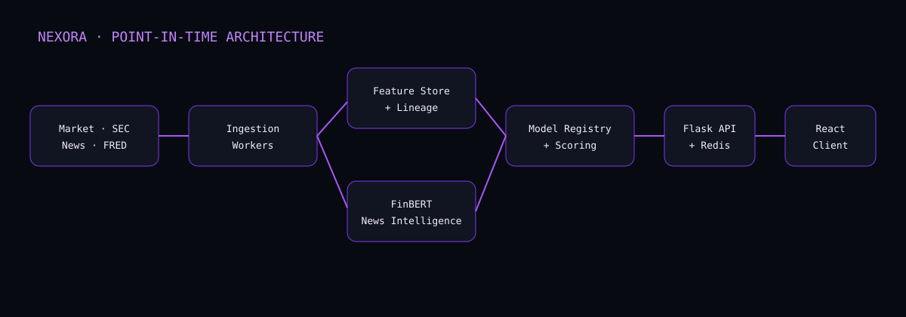
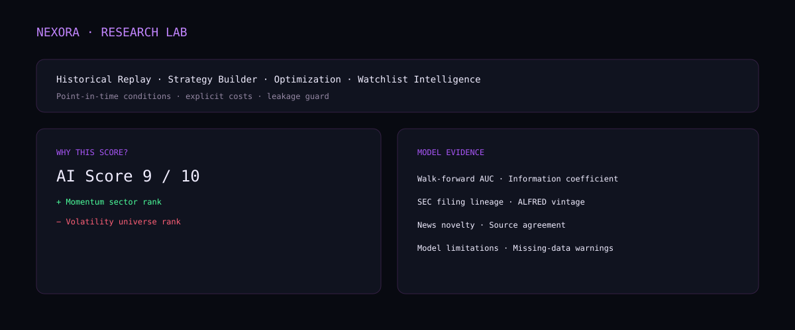

# Nexora

Nexora is a point-in-time, cross-sectional equity research platform covering the S&P 500. It combines calibrated LightGBM ranking, SEC filing fundamentals, vintage-safe macro regimes, evidence-weighted financial news, paper execution, portfolio risk, historical replay, and decision-quality journaling in one auditable system.

> Built a point-in-time, cross-sectional equity-ranking platform covering 500+ securities. Combined technical, SEC fundamental, macroeconomic, and FinBERT news features using purged walk-forward LightGBM evaluation.

Nexora is an engineering and research project—not an investment adviser, return guarantee, or live-money trading system.



## The problem

Most portfolio projects stop at next-day prediction and an attractive chart. That hides the hard parts of financial ML: revised data, delayed filings, overlapping labels, transaction costs, calibration, weak baselines, and explanations that overstate what a model knows.

Nexora asks a narrower question: given only information available on a date, which stocks are more likely to outperform SPY over the next 63 trading days?

## What makes Nexora different

- Cross-sectional S&P 500 ranking instead of single-stock extrapolation
- Forward 63-day excess-return labels and calibrated daily deciles
- Universe and sector-relative ranks
- Purged walk-forward validation with a 63-day embargo
- Point-in-time SEC acceptance timestamps, reporting lags, and XBRL lineage
- ALFRED vintages that prevent revised macro data leaking backward
- News deduplication, credibility, recency, novelty, contradictions, and topics
- Public Model Lab with baselines, calibration, costs, drawdowns, and regimes
- Historical replay and a leakage-guarded no-code backtester
- Fill-derived paper portfolios, immutable ledgers, and portfolio risk
- SHAP explanations, source links, freshness, and missing-data warnings
- Research journal analytics for rule adherence and model agreement
- Read-only recruiter demo, public model card, architecture tour, and status page



## Architecture

```text
Market / SEC / News / FRED
            ↓
Observable ingestion workers
            ↓
Point-in-time data → Feature store → Purged model training
            ↓                              ↓
FinBERT intelligence              Versioned registry
            └──────────────┬───────────────┘
                           ↓
                  Daily scoring service
                           ↓
              Redis SWR cache → Flask API
                           ↓
                      React client
```

The browser never supplies trusted prices, balances, user IDs, order totals, or model artifacts. State changes require a verified Firebase ID token and execute server-side.

## Data lineage and leakage prevention

Every fundamental retains its SEC accession, form, document, acceptance timestamp, reporting lag, XBRL concept, unit, period, and source URL. Historical macro requests pin both ALFRED real-time dates to the requested date. Historical price and breadth windows end on that same date.

Additional controls:

- No random splitting of overlapping financial labels
- Purging and embargo around walk-forward test windows
- Cross-sectional ranks calculated independently by date
- Future SEC restatements excluded from earlier snapshots
- Historical replay selects the latest snapshot on or before the requested date
- Backtests reject missing point-in-time fields instead of substituting current data
- Realized outcomes join only after prediction and portfolio selection

## ML methodology

1. Build one row per stock and trading date.
2. Calculate multi-window return, volatility, trend, RSI, drawdown, and volume features.
3. Add point-in-time fundamental, news, and macro evidence where historical coverage exists.
4. Rank features across the universe and within sectors.
5. Label whether the next 63-day stock return beats SPY.
6. Purge overlapping labels and apply a 63-day embargo.
7. Train LightGBM and calibrate probability on a later training slice.
8. Assign daily probability ranks and deciles.
9. Compare with momentum, technical-only, sentiment-only, random, and SPY baselines.

The public `#model-card` documents objective, data, bias, controls, performance, limitations, and prohibited uses. `#model-lab` exposes walk-forward AUC, information coefficient, decile spreads, long-short returns, drawdown, Sharpe, Sortino, turnover, transaction costs, calibration, regimes, and stability.

## Product surface

### Research

- AI Score, calibrated probability, universe percentile, sector percentile
- Positive and negative SHAP drivers and waterfall
- SEC fundamentals with filing links
- Market regimes from SPY, breadth, VIX, curve, credit, claims, CPI, and rates
- Evidence-weighted news intelligence
- Event timeline and score-change attribution
- Historical replay, strategy builder, and CSV trades
- Portfolio optimization and efficient frontier
- Retrieval-only assistant with facts, citations, synthesis, and trace

### Paper execution and risk

- Market, limit, stop, and stop-limit paper orders
- Fractional shares, idempotency, server validation, immutable fills
- Realized/unrealized P&L and cost basis
- Beta, volatility, Sharpe, Sortino, VaR, expected shortfall, and drawdown
- Correlation, concentration, sector exposure, stress tests, and Monte Carlo
- Minimum variance, maximum Sharpe, risk parity, AI-weighted, and constrained allocation

### Decision quality

- Thesis, catalyst, entry reasoning, risk conditions, target, invalidation
- AI score captured at thesis creation
- Post-trade reflection and rule adherence
- Win rate and return by thesis type
- Performance agreeing versus disagreeing with the model

### Production engineering

- Firebase authorization, correlation IDs, structured errors, and audit logs
- Structured JSON logs and durable error tracking
- API, provider, model, cache, freshness, and job-health metrics
- Redis cache with memory fallback and stale-while-revalidate
- Provider rate limits, exponential retry, circuit breakers, and fallback news
- Observable scheduled jobs, retry counts, failures, freshness, and dead letters
- Explicit partial responses—missing sentiment is never silently “neutral”

## Recruiter demo

Open `#demo` without an account for a seeded read-only portfolio, precomputed scores, Model Lab, architecture tour, and example research prompts. Guest mode has no trading authorization and cannot invoke protected mutations.

## Local setup

Requirements: Node.js 20+, Python 3.11, and optionally Redis.

```bash
cp .env.example .env
python3 -m venv .venv
.venv/bin/pip install -r requirements-dev.txt
npm install
.venv/bin/python -m backend.migrations
```

Run the API and client in separate terminals:

```bash
.venv/bin/python -m backend.app
npm start
```

Open <http://localhost:3000>; Flask listens on <http://localhost:5001>.

Optional provider configuration:

```env
FRED_API_KEY=your-fred-key
SEC_USER_AGENT=Nexora research your-email@example.com
REDIS_URL=redis://localhost:6379/0
ALPACA_API_KEY=paper-only-key
ALPACA_SECRET_KEY=paper-only-secret
```

Live-money Alpaca endpoints are explicitly rejected.

## Training

```bash
.venv/bin/python -m backend.training.dataset \
  --start 2018-01-01 --refresh-universe \
  --output data/features/cross_sectional.parquet

.venv/bin/python -m backend.training.cross_sectional \
  data/features/cross_sectional.parquet \
  --artifacts artifacts/cross_sectional
```

Scheduled ingestion and retraining live in `.github/workflows/`.

## Test pyramid

```bash
# Unit, API contract, provider, auth, trading, leakage, and validation tests
.venv/bin/pytest backend/tests

# Lint and dependency audit
.venv/bin/ruff check backend
.venv/bin/pip-audit -r requirements.txt
npx eslint src --ext .js
npm audit --audit-level=high

# React, build, browser, and load tests
CI=true npm test -- --watchAll=false
npm run build
npx playwright test
locust -f tests/load_test.py --host http://127.0.0.1:5001

# Migration and backend container
.venv/bin/python -m backend.migrations
docker build -t nexora-api .
```

CI runs Python and JavaScript linting, tests, dependency audits, secret scanning, frontend build, database migrations, browser tests, and container construction. The production environment gate depends on every check.

## Deployment

The backend container runs `python -m backend.app`. Supply secrets through the deployment platform, configure `NEXORA_ALLOWED_ORIGINS`, attach persistent database storage, connect managed Redis, apply migrations, publish the model artifact, and confirm the public status page before traffic.

## Known limitations

- Historical index membership can be incomplete, creating survivorship bias.
- Free providers can be delayed or revise records.
- Contextual fundamentals or sentiment absent from an artifact are labeled “context only.”
- Historical optimizer inputs are unstable estimates, not forecasts.
- Backtest interval scaling is documented as an approximation when only 63-day outcomes exist.
- Headline NLP can miss article-body nuance.
- SQLite should move to managed Postgres for multi-instance deployment.
- Process-local metrics should move to OpenTelemetry and a centralized backend.

## Future work

- Historical constituent membership and delisted securities
- Managed Postgres and distributed workers
- Centralized OpenTelemetry traces and metrics
- Broader point-in-time analyst-estimate history
- Section-level filing retrieval and citations
- Shadow deployment, drift-triggered rollback, and champion/challenger models

## Responsible use

Nexora describes historical associations and relative rankings. It does not claim to know a stock will rise, does not provide personalized financial advice, and does not support live-money trading.
